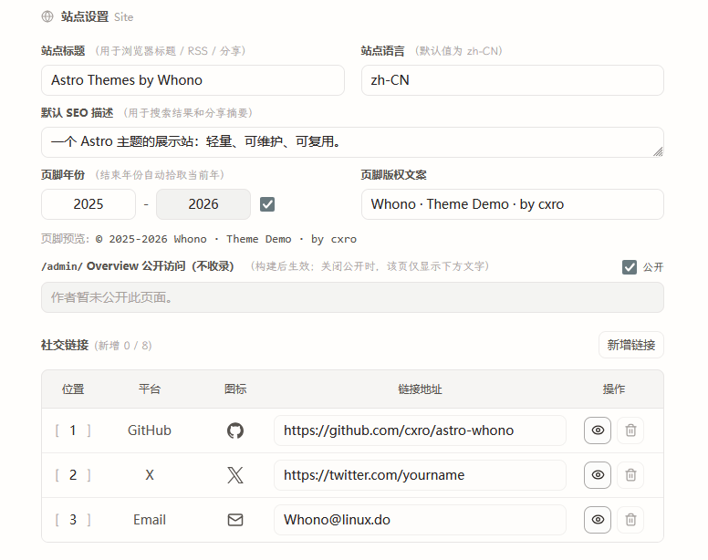
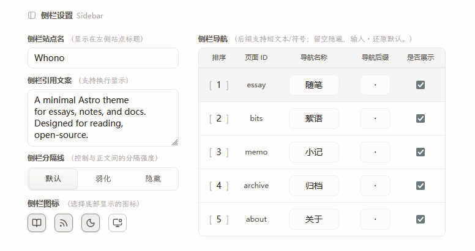
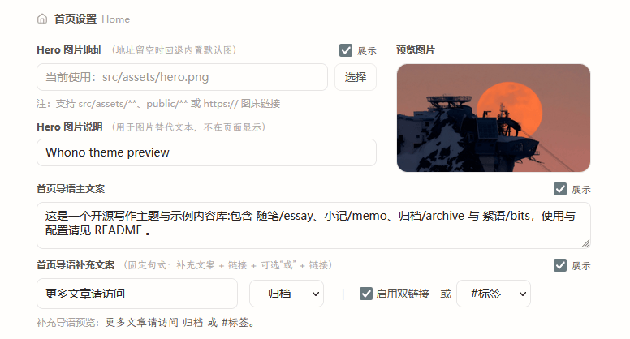

astro-whono provides a local Theme Console for centrally managing theme-level configuration in the development environment.

Theme Console is available at `/admin/theme/`. It mainly covers site information, the sidebar, home page, and inner page copy, along with some reading and code display options, making it easy to quickly adjust site theme settings after forking or cloning.

:::note[Development environment]
`/admin/theme/` can only be used in the development environment. When accessed in production, only a local development notice is shown, with no write access.
:::

## Local setup and entry point

For local development, start the project with the following commands:

```bash
npm install
npm run dev
```

By default, the development server runs at `http://localhost:4321/`. Once started, you can go directly to:

```text
http://localhost:4321/admin/theme/
```

If you changed the development port locally, replace `4321` with the actual port.

`/admin/` is the Admin's Site Overview entry point, used to view site snapshots. Theme Console is at `/admin/theme/`; be careful to distinguish between the two.

## Development and production environments

Theme Console is a configuration tool for local maintainers. Its behavior in different environments is as follows:

- Development environment: `/admin/theme/` can read and save theme configuration
- Production: `/admin/theme/` only shows the local development notice and does not display writable forms
- `/api/admin/settings/`: available only in the development environment; not for use as a public API

## Scope

Theme Console currently handles the following types of configuration:

- Site title, default language, and default SEO description
- Site icons (browser tab / touch icon)
- Footer year and copyright text
- `/admin/` Overview visibility toggle and disabled-state text
- Social links and their order
- Sidebar site name, quote text, navigation order, and visibility
- Sidebar action icons (reading mode / RSS / theme toggle / site overview entry)
- Home page Hero, home intro, and home internal entry points
- Main and subheadings for `/essay/`, `/archive/`, `/bits/`, `/memo/`, and `/about/`
- Article metadata display options
- Table of contents toggle on the right side of article pages
- Tags, Previous / Next, and share buttons at the bottom of article pages
- Code block line numbers
- Typography fonts for the four roles: body / copy / monospace / brand


## Configuration files

Saved settings are automatically written to `src/data/settings/` by group:

```text
src/data/settings/
  site.json
  shell.json
  home.json
  page.json
  ui.json
```

> If `src/data/settings/*.json` does not yet exist, it is generated automatically the first time you save in `/admin/theme/`.

Theme Console manages theme configuration within the repository, and changes can still be tracked and reverted with Git.

The theme configuration read order is fixed: `src/data/settings/*.json` takes priority, then legacy configuration, and finally project defaults. Legacy configuration here mainly comes from `site.config.mjs` and default constants inside components.<br>
In other words, a freshly cloned project can start with the default configuration; as soon as you save once in Theme Console, trackable settings JSON is generated.

## Page groups

`/admin/theme/` has six group tabs at the top: Site, Sidebar, Home, Page, Article, and Typography. One group is shown at a time. Switching groups does not affect entered values; Save, Check configuration, and Reset changes apply to all groups together.

The current group is recorded in the address bar (for example, `/admin/theme/#sidebar`) and persists across refreshes.

### Site

The Site group handles site-level basic information:

- Site title
- Default language
- Default SEO description
- Footer year and copyright text
- Whether `/admin/` Overview is publicly visible, and the text shown when it is off
- Site icons (browser tab / touch icon)
- Social links

Site icons support uploading square PNGs (16–512px, under 256KB), corresponding to the browser tab icon and mobile touch icon respectively; files are written to `public/images/site/` with content-hash names, so replacements are not affected by browser icon caching. After customizing the tab icon, the theme's default SVG / PNG icons are no longer output; the touch icon falls back independently and stays on the theme default when not customized. If icon files are missing, the site automatically falls back to the theme default icons without affecting the build. SVG icon upload is not currently supported; you can replace `public/favicon.svg` directly (manually maintained fixed paths do not carry a cache-busting stamp, so browsers may still show the old icon after replacing its contents).

> 

### Sidebar

The Sidebar group handles shell and navigation configuration:

- Sidebar site name
- Sidebar quote text
- Sidebar divider style
- Sidebar action icon visibility (reading mode / RSS / theme toggle / site overview)
- Navigation name, order, suffix character, and visibility

> 

### Home

The Home group handles home page display configuration:

- Hero image URL and caption text
- Hero visibility
- Home intro main copy
- Home intro supplementary copy
- Main link and secondary link in the supplementary intro

> 

The home supplementary intro uses a fixed sentence structure; the Admin only exposes the copy and entry point selection to keep the home structure stable. Available entry points currently include `archive`, `essay`, `bits`, `memo`, `about`, and `tag`.


### Page

The Page group handles titles and default author for inner pages:

- Main and subheadings for `/essay/`
- Main and subheadings for `/archive/`
- Main and subheadings for `/bits/`
- Main and subheadings for `/memo/`
- Main and subheadings for `/about/`
- Default author name and avatar for `/bits/`

> 

### Article

The Article group handles display options for article pages:

- Whether article metadata shows date, tags, word count, and reading time
- Article tag placement: below the title, at the bottom of the body, and in lists can be toggled separately; by default, article pages show tags only at the bottom of the body
- Whether to show Previous / Next at the bottom of the article
- Which share buttons to show at the bottom of the article: X, Facebook, Weibo, Telegram, LinkedIn, email, share card, and copy link; if all are deselected, none are shown; when `SITE_URL` is not set, only the share card and copy link take effect
- Whether to show the table of contents on the right side of article pages (`/archive/` detail pages): the TOC appears only on wide screens of 1440px and above, and is not shown for articles with fewer than 2 section headings
- Whether to show line numbers in code blocks

> 

### Typography

The Typography group handles the selection of four typography font roles:

- Body font (article body and headings)
- Copy font (intros, About page, and similar contexts)
- Monospace font (code blocks and inline code)
- Brand font (sidebar site name and quote)

Saved changes are written to `src/data/settings/ui.json` and take effect on the next build. For font sources, sizes, and how to add custom fonts, see "Typography fonts" below.

> 


## Typography fonts

The four font roles each select from a set of font cards: each card previews sample text rendered in that font and labels its source, making it easy to choose as needed. Built-in options come from three source categories:

- **System fonts**: use fonts already available on the visitor's device and produce no downloads.
- **Self-hosted fonts**: font files are distributed with the site build output, so visitors do not go through any external CDN and pages make no third-party requests.
- **Online fonts**: downloaded from open-source font libraries (fontsource / Google Fonts) at build time and then self-hosted; pages likewise make zero third-party requests, but the build machine needs access to the corresponding font source.

A single weight of a Chinese font is usually over 1 MB, while system fonts require zero downloads; use this to balance appearance and size.

### Adding fonts outside the card list

Card options come from the font registry `src/lib/fonts/registry.ts`. If you need a font outside the list, add a configuration entry for that font at the end of `THEME_FONT_REGISTRY`; the selection card, validation, and page styles will then take effect without modifying other files.

To ensure reproducible builds and third-party-free pages, the registry accepts only pre-registered fonts; the interface does not support entering arbitrary font names directly. Each font uses one syntax depending on how it is obtained; see the comments in the file for the meaning of each field:

| Acquisition method | Use case | Key fields |
|---|---|---|
| `system` | System font stack | `fallbacks`; produces no downloads |
| `astro-fonts-api` | Open-source online fonts | `provider` (`fontsource` has better availability in mainland China / `google` requires access to fonts.google.com), `familyName`; Chinese fonts must declare `subsets` (such as `['chinese-simplified', 'latin']`), otherwise Chinese glyphs will not be bundled |
| `astro-fonts-api` + `provider: 'local'` | Offline builds or builds without internet access | Place font files in `src/assets/fonts/` and fill in `localVariants`; the build does not depend on the network |
| `subset-pipeline` | Chinese subsetting and compression needed | Also requires source fonts, `scripts/font-subset.mjs`, and `global.css` support; refer to the existing default fonts |

If an online font fails to download during the build, pages automatically fall back to system fonts and the build continues; running `SITE_URL=... npm run check:prod-artifacts` reports such silent degradation as an explicit error. In development mode, after switching to one of these fonts, you need to restart the development server to see the effect.


## Saving behavior

- Saves are written back by `site / shell / home / page / ui` group and do not directly modify template source code
- Most fields provide instant preview or a clear page mapping
- Field validation runs before saving; if validation fails, the interface automatically switches to the group containing the first error field, and the tab for that group shows a red dot
- Saves include version information to avoid silent overwrites caused by concurrent modifications
- The write process includes failure rollback to avoid partial success across multiple files

---

The above covers the current common configuration entry points and saving behavior of Theme Console. If you encounter configuration anomalies or saving issues while using it, feel free to submit an Issue.
